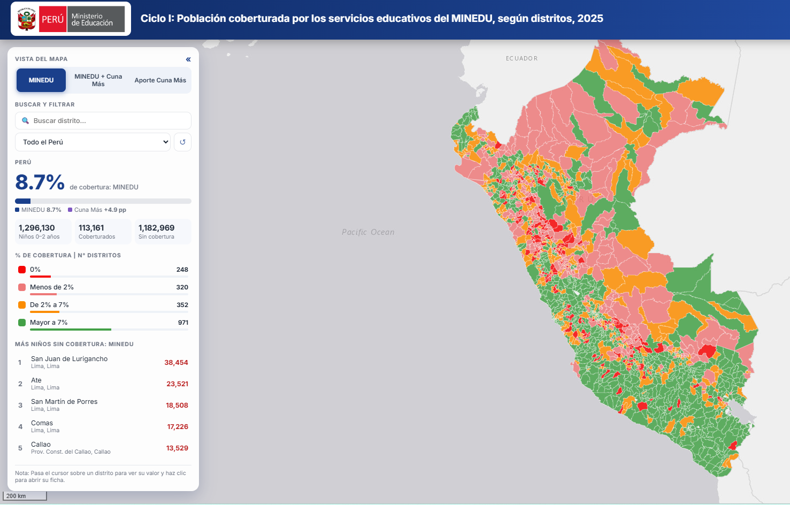

# Cobertura de la población de 0 a 2 años, 2025

Mapa dinámico de la población de 0 a 2 años (Ciclo I) coberturada por los servicios educativos del **MINEDU** y por el Servicio de Cuidado Diurno (SCD) del **Programa Nacional Cuna Más**, según distritos, 2025.

**[Ver el mapa interactivo](https://lbautistab.github.io/Cobertura_CicloI/)**



## Cifras clave (Perú, 2025)

| Indicador | MINEDU | MINEDU + Cuna Más |
| --- | --- | --- |
| Niños de 0 a 2 años | 1,296,130 | 1,296,130 |
| Niños atendidos | 113,161 | 176,885 |
| Cobertura | 8.7% | 13.6% |
| Niños sin cobertura | 1,182,969 | 1,119,245 |
| Distritos sin ningún niño atendido | 248 | 233 |

## Qué permite el mapa

- **Tres vistas:** cobertura MINEDU, cobertura MINEDU + Cuna Más y aporte de Cuna Más en puntos porcentuales.
- **Panel de indicadores** que se recalcula por región: población, coberturados y no coberturados.
- **Leyenda interactiva:** haz clic en una categoría del semáforo para mostrar solo esos distritos.
- **Buscador de distritos** y **filtro por región**.
- **Top 5 de distritos** con más niños sin cobertura.
- **Ficha por distrito** que muestra solo la información de la vista elegida.
- Mapas base gris y satélite, minimapa, escala y pantalla completa.

## Semaforización

| Color | Cobertura |
| --- | --- |
| Rojo | 0% |
| Rojo suave | Menos de 2% |
| Naranja | De 2% a 7% |
| Verde | Más de 7% |

## Archivos

| Archivo | Descripción |
| --- | --- |
| `Mapa_Cobertura_Integrado_CicloI_2025.html` | Mapa interactivo autocontenido (se abre en cualquier navegador) |
| `MAPA_DINAMICO_COBERTURA_CICLO_I_2025_INTEGRADO.R` | Script en R que genera el mapa |
| `index.html` | Redirige al mapa cuando se publica con GitHub Pages |

## Cómo reproducirlo

1. Instala los paquetes de R:

   ```r
   install.packages(c("tidyverse", "readxl", "mapsPERU", "sf", "leaflet",
                      "htmlwidgets", "htmltools", "base64enc", "rmapshaper"))
   ```

2. Coloca en la misma carpeta del script:
   - `Ciclo I-Población coberturada y no cobertura por distritos 2025.xlsx` (hoja `BD`)
   - `Minedu.png`, `CunaMas.png` y `MineduCunaMas.png` (logos del encabezado)

3. Ejecuta el script. Se genera `Mapa_Cobertura_Integrado_CicloI_2025.html`.

## Fuentes

Padrón Nominal 2025, SIAGIE 2025 y Padrón Cuna Más 2025.

## Autor

Luis Bautista
